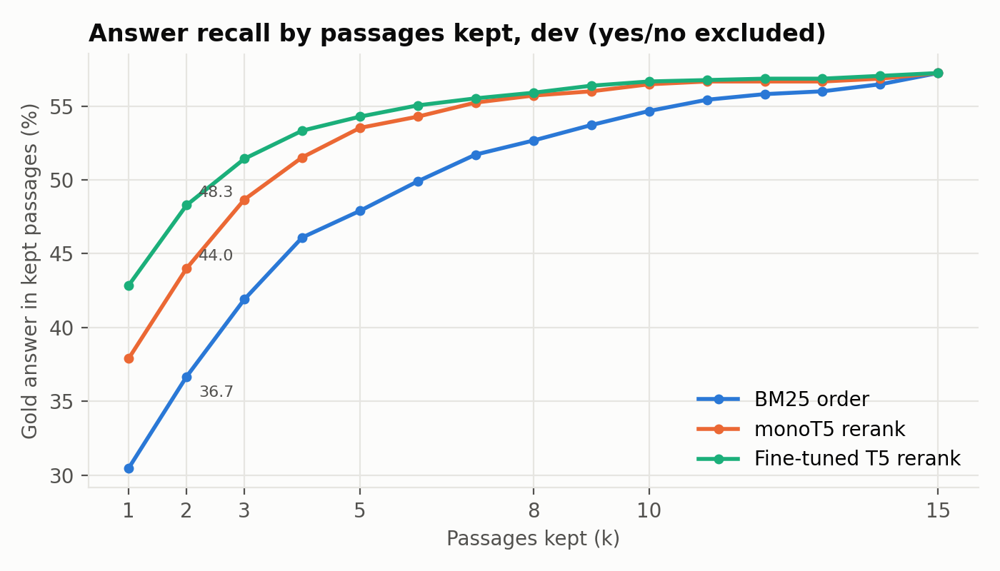
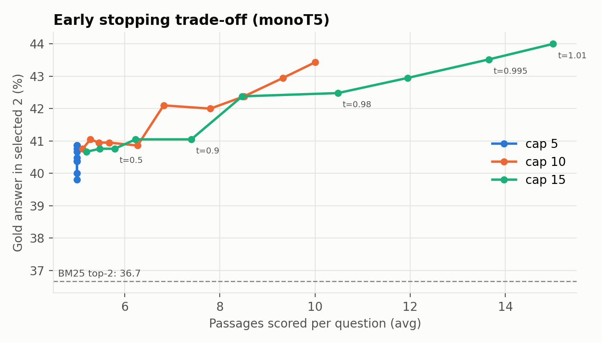
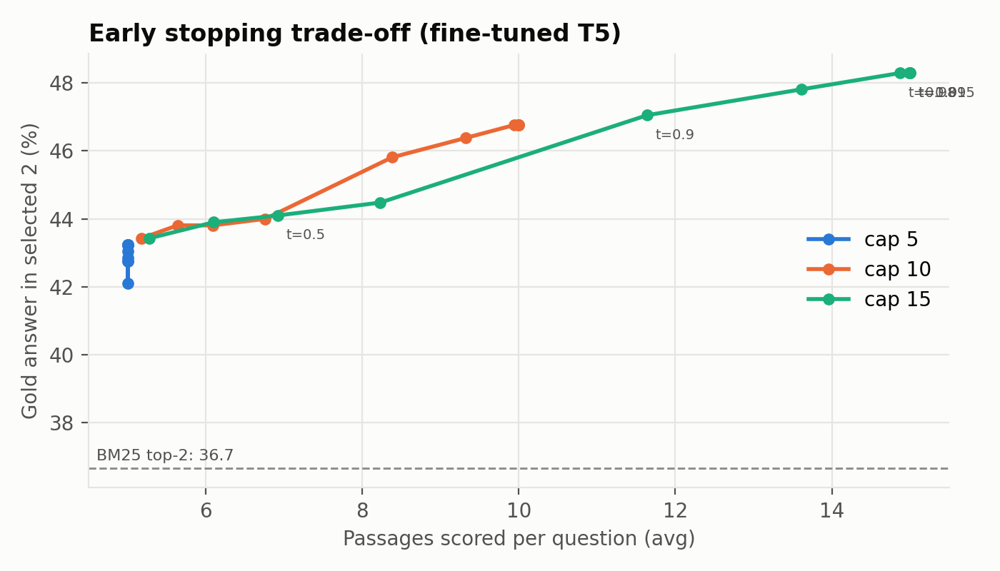
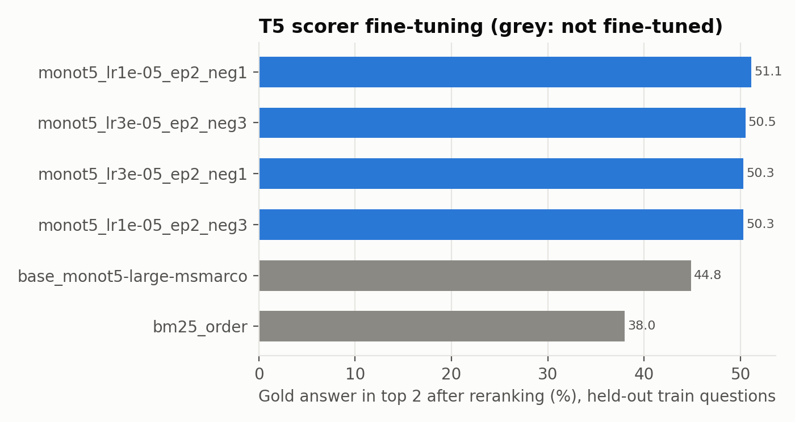
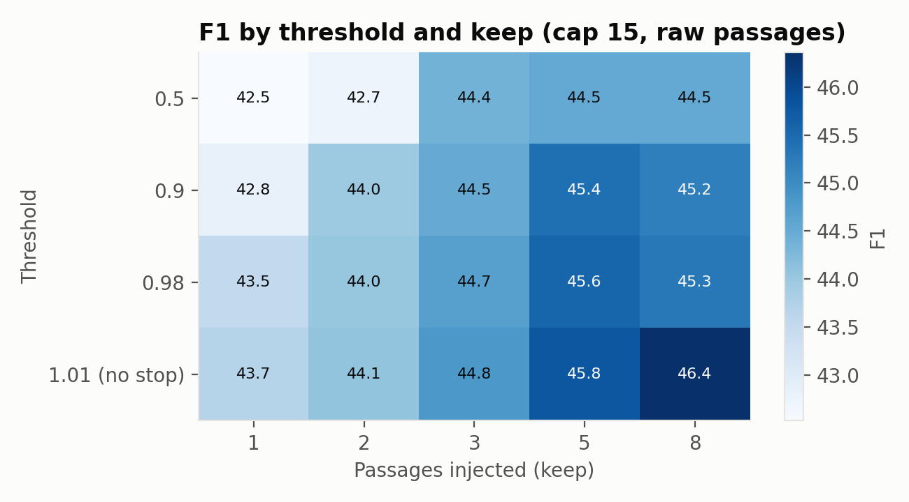
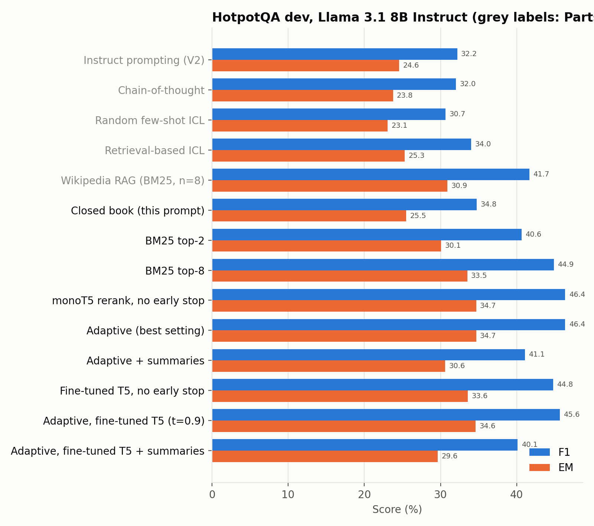
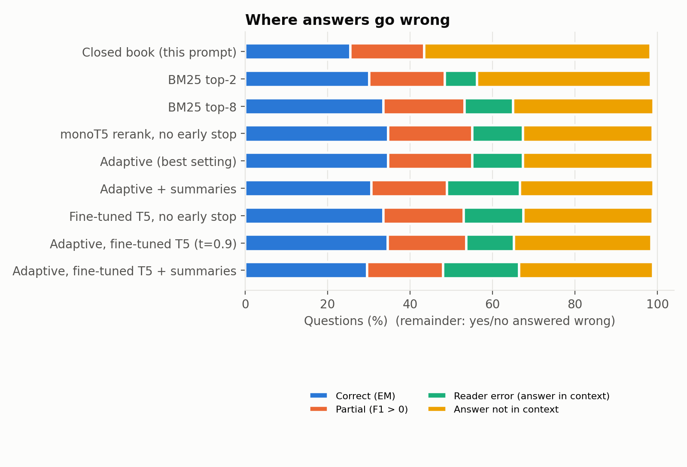
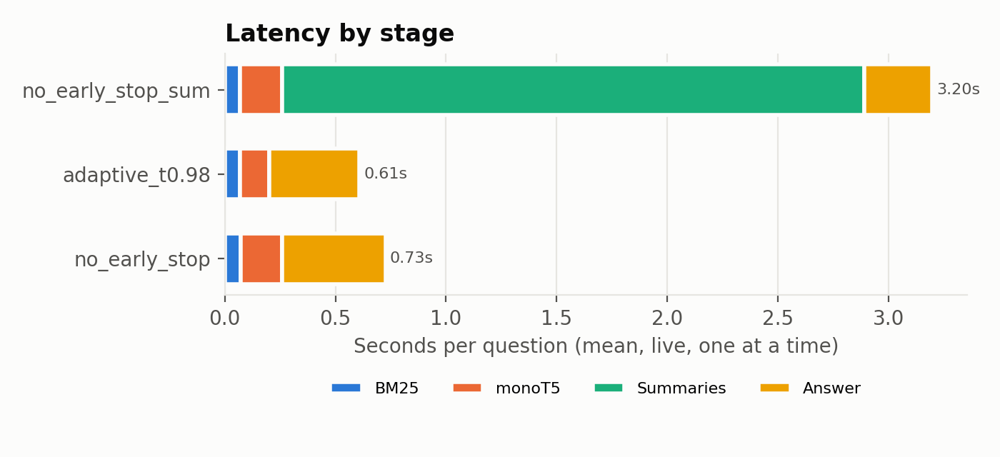

# Project 2 results

Generated by `python report.py` from the files in `outputs/`.

## Retrieval and reranking

| Order | @1 | @2 | @3 | @5 | @8 | @10 | @15 |
|---|---|---|---|---|---|---|---|
| BM25 order | 30.48 | 36.67 | 41.90 | 47.90 | 52.67 | 54.67 | 57.24 |
| monoT5 rerank | 37.90 | 44.00 | 48.67 | 53.52 | 55.71 | 56.48 | 57.24 |
| Fine-tuned T5 rerank | 42.86 | 48.29 | 51.43 | 54.29 | 55.90 | 56.67 | 57.24 |

monoT5 scores 15 passages in 1.490s per question on average (1110 dev questions, 60 yes/no excluded from recall).

## Adaptive early stopping (offline replay)

### Threshold sweep, monoT5 (cap 15, keep 2)

| threshold | fallback % | docs scored | stopped early % | gold in selected % |
|---|---|---|---|---|
| 0.1 | 1.17 | 5.20 | 98.83 | 40.67 |
| 0.3 | 2.97 | 5.48 | 97.03 | 40.76 |
| 0.5 | 5.59 | 5.79 | 94.41 | 40.76 |
| 0.7 | 9.19 | 6.23 | 90.81 | 41.05 |
| 0.9 | 20.72 | 7.40 | 79.28 | 41.05 |
| 0.95 | 31.26 | 8.47 | 68.74 | 42.38 |
| 0.98 | 52.25 | 10.48 | 47.75 | 42.48 |
| 0.99 | 68.47 | 11.95 | 31.53 | 42.95 |
| 0.995 | 86.22 | 13.65 | 13.78 | 43.52 |
| 1.01 | 100.00 | 15.00 | 0.00 | 44.00 |

### Threshold sweep, fine-tuned T5 (cap 15, keep 2)

| threshold | fallback % | docs scored | stopped early % | gold in selected % |
|---|---|---|---|---|
| 0.1 | 1.53 | 5.28 | 98.47 | 43.43 |
| 0.3 | 7.39 | 6.10 | 92.61 | 43.90 |
| 0.5 | 14.05 | 6.92 | 85.95 | 44.10 |
| 0.7 | 26.40 | 8.23 | 73.60 | 44.48 |
| 0.9 | 63.78 | 11.64 | 36.22 | 47.05 |
| 0.95 | 85.50 | 13.61 | 14.50 | 47.81 |
| 0.98 | 98.74 | 14.87 | 1.26 | 48.29 |
| 0.99 | 99.91 | 14.99 | 0.09 | 48.29 |
| 0.995 | 100.00 | 15.00 | 0.00 | 48.29 |
| 1.01 | 100.00 | 15.00 | 0.00 | 48.29 |

## Scorer fine-tuning

| Run | lr | neg ratio | best epoch | gold@1 | gold@2 | gold@5 | MRR |
|---|---|---|---|---|---|---|---|
| monot5_lr1e-05_ep2_neg1 | 1e-05 | 1 | 1 | 44.44 | 51.11 | 56.97 | 0.50 |
| monot5_lr3e-05_ep2_neg3 | 3e-05 | 3 | 1 | 46.06 | 50.51 | 56.57 | 0.50 |
| monot5_lr3e-05_ep2_neg1 | 3e-05 | 1 | 2 | 46.06 | 50.30 | 56.77 | 0.50 |
| monot5_lr1e-05_ep2_neg3 | 1e-05 | 3 | 1 | 45.66 | 50.30 | 56.97 | 0.50 |
| base_monot5-large-msmarco | 0 | 0 |  | 36.77 | 44.85 | 54.14 | 0.44 |
| bm25_order | 0 | 0 |  | 29.09 | 37.98 | 48.69 | 0.37 |

## End-to-end sweep

| threshold | keep | EM | F1 | gold in context % | docs scored | fallback % |
|---|---|---|---|---|---|---|
| 0.5 | 1 | 30.90 | 42.52 | 36.19 | 5.79 | 5.59 |
| 0.5 | 2 | 30.90 | 42.71 | 40.76 | 5.79 | 5.59 |
| 0.5 | 3 | 32.52 | 44.35 | 44.67 | 5.79 | 5.59 |
| 0.5 | 5 | 32.61 | 44.52 | 46.67 | 5.79 | 5.59 |
| 0.5 | 8 | 32.52 | 44.53 | 46.76 | 5.79 | 5.59 |
| 0.9 | 1 | 31.17 | 42.80 | 36.38 | 7.40 | 20.72 |
| 0.9 | 2 | 32.25 | 43.96 | 41.05 | 7.40 | 20.72 |
| 0.9 | 3 | 32.61 | 44.49 | 43.71 | 7.40 | 20.72 |
| 0.9 | 5 | 33.69 | 45.43 | 45.71 | 7.40 | 20.72 |
| 0.9 | 8 | 33.42 | 45.18 | 46.10 | 7.40 | 20.72 |
| 0.98 | 1 | 31.98 | 43.52 | 37.71 | 10.48 | 52.25 |
| 0.98 | 2 | 32.16 | 44.03 | 42.48 | 10.48 | 52.25 |
| 0.98 | 3 | 32.79 | 44.68 | 44.95 | 10.48 | 52.25 |
| 0.98 | 5 | 33.96 | 45.57 | 47.43 | 10.48 | 52.25 |
| 0.98 | 8 | 33.51 | 45.28 | 48.48 | 10.48 | 52.25 |
| 1.01 | 1 | 32.25 | 43.69 | 37.90 | 15.00 | 100.00 |
| 1.01 | 2 | 32.34 | 44.06 | 44.00 | 15.00 | 100.00 |
| 1.01 | 3 | 33.24 | 44.81 | 48.67 | 15.00 | 100.00 |
| 1.01 | 5 | 34.59 | 45.78 | 53.52 | 15.00 | 100.00 |
| 1.01 | 8 | 34.68 | 46.36 | 55.71 | 15.00 | 100.00 |

Chosen setting: {'threshold': 1.01, 'cap': 15, 'keep': 8} (from sweep_th1.01_cap15_k8, F1 46.36).

## End-to-end results

| System | Run | EM | F1 | Gold in context % | Fallback % |
|---|---|---|---|---|---|
| Naive prompting | Parts 1-3 | 5.23 | 12.37 |  |  |
| Instruct prompting (V2) | Parts 1-3 | 24.59 | 32.20 |  |  |
| Chain-of-thought | Parts 1-3 | 23.78 | 32.02 |  |  |
| Random few-shot ICL | Parts 1-3 | 23.06 | 30.67 |  |  |
| Retrieval-based ICL | Parts 1-3 | 25.32 | 34.01 |  |  |
| Wikipedia RAG (BM25, n=8) | Parts 1-3 | 30.90 | 41.68 |  |  |
| Closed book (this prompt) | closed_book | 25.50 | 34.77 | 0.00 | 0.00 |
| BM25 top-2 | bm25_k2_raw | 30.09 | 40.63 | 36.67 | 0.00 |
| BM25 top-8 | bm25_k8_raw | 33.51 | 44.87 | 52.67 | 0.00 |
| monoT5 rerank, no early stop | best_nostop_raw | 34.68 | 46.36 | 55.71 | 100.00 |
| Adaptive (best setting) | best_raw | 34.68 | 46.36 | 55.71 | 100.00 |
| Adaptive + summaries | best_sum | 30.63 | 41.07 | 55.71 | 100.00 |
| Fine-tuned T5, no early stop | ft_nostop_raw | 33.60 | 44.77 | 55.90 | 100.00 |
| Adaptive, fine-tuned T5 (t=0.9) | ft_th0.9_raw | 34.59 | 45.64 | 52.76 | 63.78 |
| Adaptive, fine-tuned T5 + summaries | ft_best_sum | 29.64 | 40.13 | 55.90 | 100.00 |

### By question type

| System | EM bridge | F1 bridge | EM comparison | F1 comparison |
|---|---|---|---|---|
| Closed book (this prompt) | 18.21 | 27.78 | 55.81 | 63.84 |
| BM25 top-2 | 25.47 | 36.63 | 49.30 | 57.25 |
| BM25 top-8 | 28.94 | 40.84 | 52.56 | 61.63 |
| monoT5 rerank, no early stop | 30.39 | 42.67 | 52.56 | 61.74 |
| Adaptive (best setting) | 30.39 | 42.67 | 52.56 | 61.74 |
| Adaptive + summaries | 25.81 | 37.02 | 50.70 | 57.95 |
| Fine-tuned T5, no early stop | 28.60 | 40.36 | 54.42 | 63.10 |
| Adaptive, fine-tuned T5 (t=0.9) | 30.17 | 41.86 | 53.02 | 61.40 |
| Adaptive, fine-tuned T5 + summaries | 24.47 | 35.79 | 51.16 | 58.19 |

### Error analysis

| System | Correct (EM) | Partial (F1 > 0) | Reader error (answer in context) | Answer not in context |
|---|---|---|---|---|
| Closed book (this prompt) | 25.50 | 17.93 | 0.00 | 54.95 |
| BM25 top-2 | 30.09 | 18.38 | 7.84 | 42.16 |
| BM25 top-8 | 33.51 | 19.73 | 11.71 | 34.05 |
| monoT5 rerank, no early stop | 34.68 | 20.45 | 12.25 | 31.44 |
| Adaptive (best setting) | 34.68 | 20.45 | 12.25 | 31.44 |
| Adaptive + summaries | 30.63 | 18.38 | 17.66 | 32.43 |
| Fine-tuned T5, no early stop | 33.60 | 19.46 | 14.41 | 31.35 |
| Adaptive, fine-tuned T5 (t=0.9) | 34.59 | 19.10 | 11.53 | 33.33 |
| Adaptive, fine-tuned T5 + summaries | 29.64 | 18.38 | 18.47 | 32.43 |

Retrieval miss: wrong, and the gold answer is not in any injected passage. Reader error: wrong although it is.

## Ablations

### Fallback when nothing passes the threshold

| Variant | EM | F1 | Gold in context % | Contexts | Docs scored |
|---|---|---|---|---|---|
| Best-scored passages anyway | 34.68 | 46.36 | 55.71 | 8.00 | 15.00 |
| BM25 top-k | 33.51 | 44.87 | 52.67 | 8.00 | 15.00 |
| No documents (closed book) | 25.50 | 34.77 | 0.00 | 0.00 | 15.00 |

### Summarizer

| Variant | EM | F1 | Gold in context % | Contexts | Docs scored |
|---|---|---|---|---|---|
| Raw passages | 34.68 | 46.36 | 55.71 | 8.00 | 15.00 |
| Llama summaries | 30.63 | 41.07 | 55.71 | 8.00 | 15.00 |
| Summaries, drop 'Not relevant' | 30.72 | 41.05 | 55.71 | 7.61 | 15.00 |

### Early stopping

| Variant | EM | F1 | Gold in context % | Contexts | Docs scored |
|---|---|---|---|---|---|
| Adaptive (best threshold) | 34.68 | 46.36 | 55.71 | 8.00 | 15.00 |
| Score all 15 | 34.68 | 46.36 | 55.71 | 8.00 | 15.00 |

### Scorer, no early stopping

| Variant | EM | F1 | Gold in context % | Contexts | Docs scored |
|---|---|---|---|---|---|
| monoT5 (MS MARCO) | 34.68 | 46.36 | 55.71 | 8.00 | 15.00 |
| Fine-tuned on HotpotQA train | 33.60 | 44.77 | 55.90 | 8.00 | 15.00 |

### Scorer, matched effort

| Variant | EM | F1 | Gold in context % | Contexts | Docs scored |
|---|---|---|---|---|---|
| monoT5, best threshold | 34.68 | 46.36 | 55.71 | 8.00 | 15.00 |
| Fine-tuned, threshold 0.9 | 34.59 | 45.64 | 52.76 | 5.69 | 11.64 |

## Latency

| Setting | BM25 s | monoT5 s | Summaries s | Answer s | Total s | Docs scored |
|---|---|---|---|---|---|---|
| no_early_stop | 0.07 | 0.19 | 0.00 | 0.47 | 0.73 | 15.00 |
| adaptive_t0.98 | 0.07 | 0.13 | 0.00 | 0.41 | 0.61 | 10.35 |
| no_early_stop_sum | 0.07 | 0.19 | 2.63 | 0.31 | 3.20 | 15.00 |

## Example cases (best_raw)

### Correct

- **Q:** Are Lochner v. New York and Cooley v. Board of Wardens both Supreme Court cases dealing with labor laws?  
  **Gold:** no  **Predicted:** no  
  Passages: Lochner v. New York, Lochner v. New York, Lochner v. New York, United States labor law, Baker, Lochner era, Cooley v. Board of Wardens, Lochner v. New York
- **Q:** What occupation is shared by both Marge Piercy and Richard Aldington?  
  **Gold:** poet  **Predicted:** Poet  
  Passages: Richard Aldington, Richard Aldington, Marge Piercy, Richard Aldington, The Plumed Serpent, Marge Piercy, Richard Aldington, Marge Piercy
- **Q:** An actress in Strange Fruit was better known for a role in CBS sitcom.  Which sitcom is this actress better known for than her role in Strange Fruit?  
  **Gold:** The Jeffersons  **Predicted:** The Jeffersons  
  Passages: Andrea Anders, Marla Gibbs, Andrea Anders, Anna Maria Horsford, Erinn Hayes, Tracy Vilar, Téa Leoni, Jennifer Finnigan
- **Q:** When was the actor who plays Marius Josipovic in Sneaky Pete born?  
  **Gold:** December 17, 1974  **Predicted:** December 17, 1974  
  Passages: Giovanni Ribisi, Sneaky Pete, Giovanni Ribisi, Giovanni Ribisi, Ethan Embry, Peter Gerety, Sneaky Pete Kleinow, Libe Barer

### Reader errors

- **Q:** The Swiss immigration referendum, February 2014 is an example of what, which was framed by bilateral treaties between Switzerland and the European Union?  
  **Gold:** relations between Switzerland and the European Union  **Predicted:** Euroscepticism  
  Passages: 2014 Swiss immigration initiative, Modern history of Switzerland, Continuing United Kingdom relationship with the European Union, Euroscepticism, Switzerland–European Union relations, 2014 Swiss immigration initiative, 2014 Swiss immigration initiative, 2014 Swiss immigration initiative
- **Q:** Choi Jun-hong  is best known as a member of a group formed in which year ?  
  **Gold:** 2012  **Predicted:** B.A.P  
  Passages: Zelo, Zelo, Cool (band), Victon, Choi Jung-yoon, Jun Kung, Choi Jung-yoon, Charlene Choi
- **Q:** Who replaced the manager of the Aston Villa that began at Leeds United?  
  **Gold:** Martin O'Neill  **Predicted:** David O'Leary  
  Passages: Roy Aitken, History of Aston Villa F.C. (1961–present), 2003–04 Aston Villa F.C. season, 2007–08 in English football, 2003–04 Aston Villa F.C. season, Eric Lichaj, Fabian Delph, 1996 Football League Cup Final
- **Q:** Which Skagen Painter favored naturalism along with Theodor Esbern Philipsen and Kristian Zahrtmann?  
  **Gold:** Peder Severin Krøyer  **Predicted:** Johannes Wilhjelm  
  Passages: Kristian Zahrtmann, Johannes Wilhjelm, Jørgen Aabye, Danish art, Joakim Skovgaard, Funen Painters, Kristian Zahrtmann, Kristian Zahrtmann

### Retrieval misses

- **Q:** What is the birthday of the actress who was the Duchess in "The Revengers Tragedy"?  
  **Gold:** 23 November 1946  **Predicted:** Not available  
  Passages: The Duchess of Malfi, The Duchess of Malfi, Revengers Tragedy, The Duchess of Padua, Revengers Tragedy, Revengers Tragedy, English literature, The Revenger's Tragedy
- **Q:** Who lived longer, American author Owen Wister or Canadian author Lucy Maud Montgomery?   
  **Gold:** Owen Wister  **Predicted:** Lucy Maud Montgomery  
  Passages: Lucy Maud Montgomery, Lucy Maud Montgomery, Lucy Maud Montgomery, The Selected Journals of L. M. Montgomery, The Selected Journals of L. M. Montgomery, Lucy Maud Montgomery, Lucy Maud Montgomery, Lucy Maud Montgomery
- **Q:** What screenplay was worked on by both Edward Carfagno and Miklos Rozsa?  
  **Gold:** Julius Caesar  **Predicted:** None, as they worked on different projects  
  Passages: Quo Vadis (1951 film), Quo Vadis (1951 film), God Told Me To, Ivanhoe (1952 film), Ada (film), The Thief of Bagdad (1940 film), Knights of the Round Table (film), Ada (film)
- **Q:** Besides Jennifer Lawrence, Chris Pratt, Michael Sheen, and Laurence Fishburne, who else acted in the movie, "Passengers?"  
  **Gold:** Gene Serdena  **Predicted:** Andy Garcia  
  Passages: Passengers (2016 film), Passengers (2016 film), Passengers (2016 film), Thomas Newman, Jennifer Lawrence, Passengers (2016 film), Chris Pratt, Laurence Fishburne
